**Un buen resultado de etiquetado depende de todo el proceso: imprimir, conducir el material, recoger la bobina y aplicar la etiqueta.** Una impresora bien elegida necesita complementos que trabajen al mismo ritmo y respeten las características del consumible.

Una bobina que se desplaza lateralmente, una recogida demasiado tensa o un sensor que no detecta bien una etiqueta transparente pueden convertir una tarea sencilla en una sucesión de ajustes. A menudo, la mejora empieza en un detalle: una guía, un mandril adecuado o el sistema de dispensación correcto.

En S-IE te ayudamos a valorar los **accesorios para impresoras de etiquetas** dentro del conjunto de la solución. La gama Labelmate ofrece equipos para rebobinar, desbobinar, dispensar, contar y acabar etiquetas, con configuraciones que hay que seleccionar según cada aplicación.

## ¿Qué aporta cada tipo de equipo Labelmate?

### Rebobinadores: recoger las etiquetas con orden

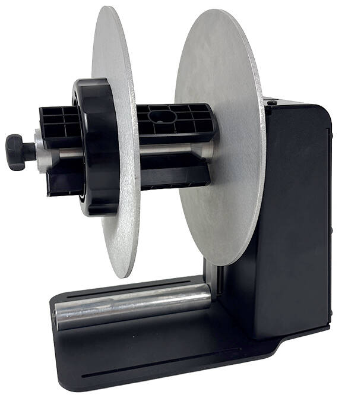

Un **rebobinador de etiquetas** recoge el material que sale de la impresora y lo prepara en bobina para manipularlo o utilizarlo después. Labelmate dispone de familias como MINI-CAT, CAT-3 y UNI-CAT, con distintas capacidades y sistemas de sujeción. La selección depende del ancho del soporte, el tamaño y el peso de la bobina y la velocidad de trabajo.

La gama **MC-PRO** incorpora Smart Tension Control, un control de tensión que adapta el funcionamiento a los cambios de velocidad y a los retrocesos del material. Esta función es relevante cuando la impresora necesita hacer avanzar y retroceder el soporte durante su ciclo. Siempre hay que verificar la compatibilidad con el modelo y la configuración de impresión.

### Desbobinadores: alimentar la impresora de forma adecuada

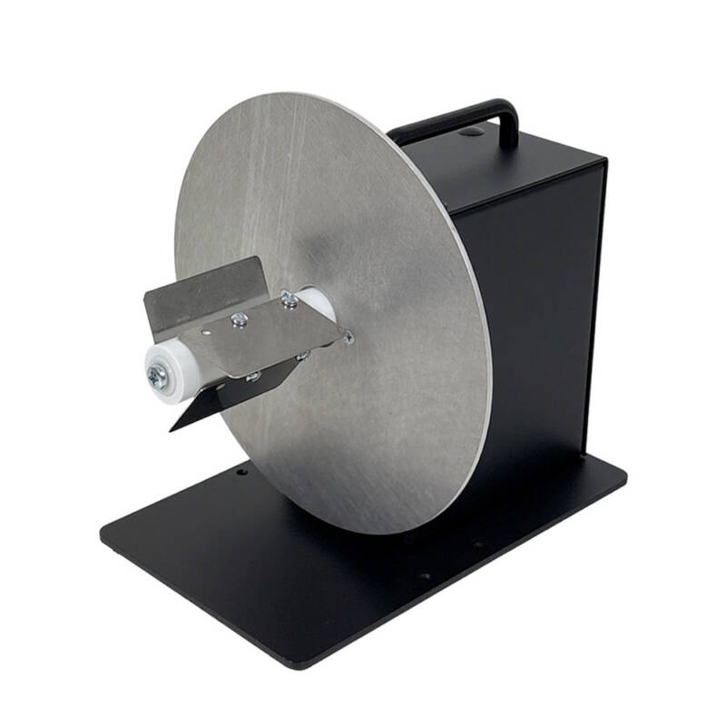

Un **desbobinador de etiquetas** sostiene la bobina a la entrada del proceso. Puede ser útil cuando el formato de suministro no encaja en el portabobinas interno o cuando se busca más autonomía entre cambios, siempre dentro de la capacidad admitida por el conjunto.

Aquí importan la resistencia al arrastre, el recorrido del soporte y la alineación con la entrada de la impresora. La bobina más grande solo es una buena elección si el sistema la puede gestionar correctamente.

### Dispensadores: facilitar la aplicación manual

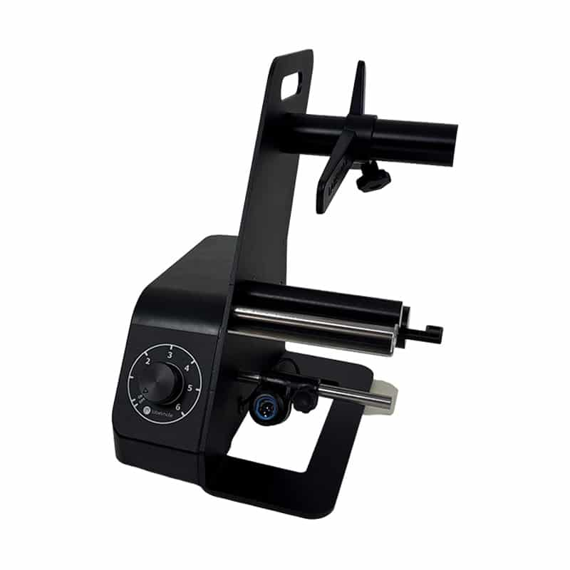

Los **dispensadores de etiquetas Labelmate** separan la etiqueta del papel soporte y la presentan para que el operario la recoja. Al retirarla, avanza la siguiente. La gama LD incluye distintos anchos y versiones para etiquetas convencionales o transparentes; también hay modelos C2 con contador integrado.

Es una opción que conviene valorar en puestos de envasado, preparación de pedidos o identificación de componentes. **Dispensar y aplicar son operaciones diferentes:** un dispensador facilita la recogida, pero la colocación sobre el producto sigue siendo manual.

### Contadores: preparar cantidades definidas

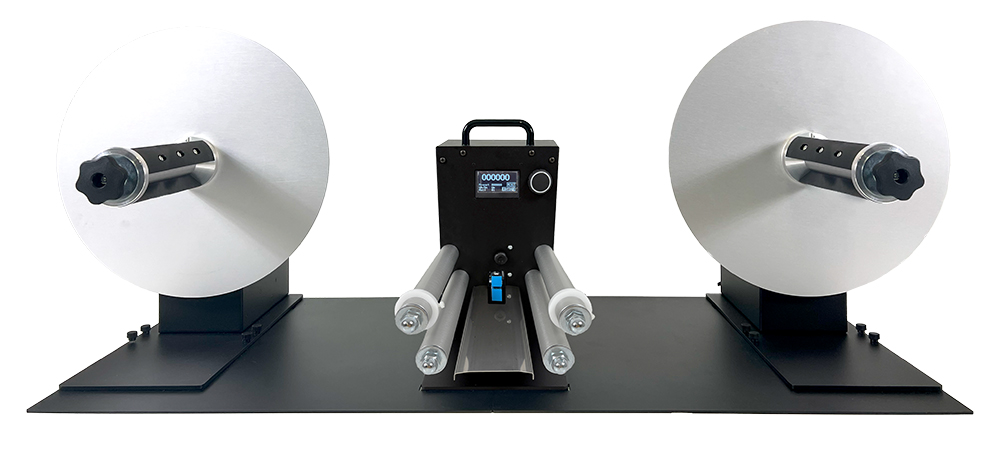

Los **contadores de etiquetas**, como las familias COUNT y las estaciones de bobina a bobina, permiten gestionar cantidades y preparar lotes según la configuración elegida. En aplicaciones con etiquetas transparentes o de formas especiales, las versiones de conteo con sensor ultrasónico pueden ser especialmente adecuadas.

Contar unidades no comprueba el contenido impreso ni la calidad del código de barras. Si se necesita esa verificación, hay que definir una función de control específica.

### Corte longitudinal y retirada de matriz

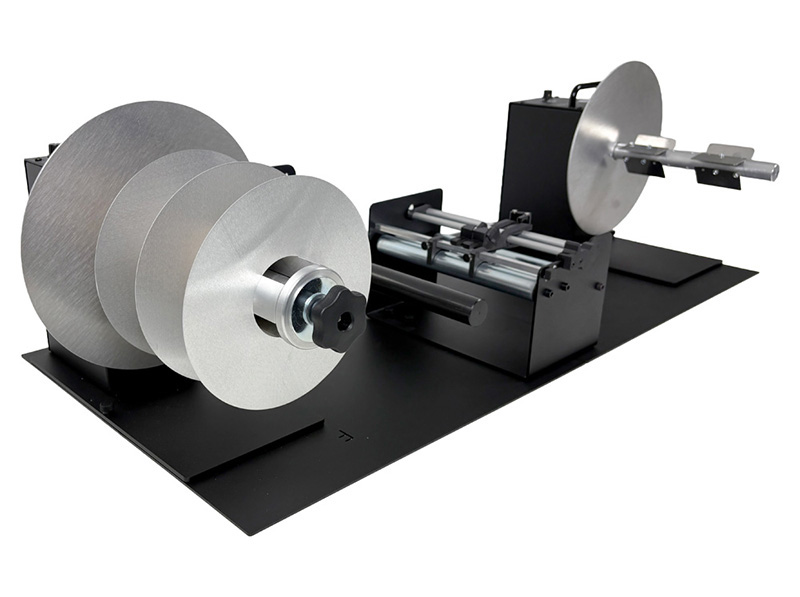

Labelmate también ofrece **soluciones de corte longitudinal** para dividir bandas y equipos para retirar la matriz sobrante de etiquetas troqueladas. Son operaciones de acabado que hay que dimensionar según el material y la bobina final requerida.

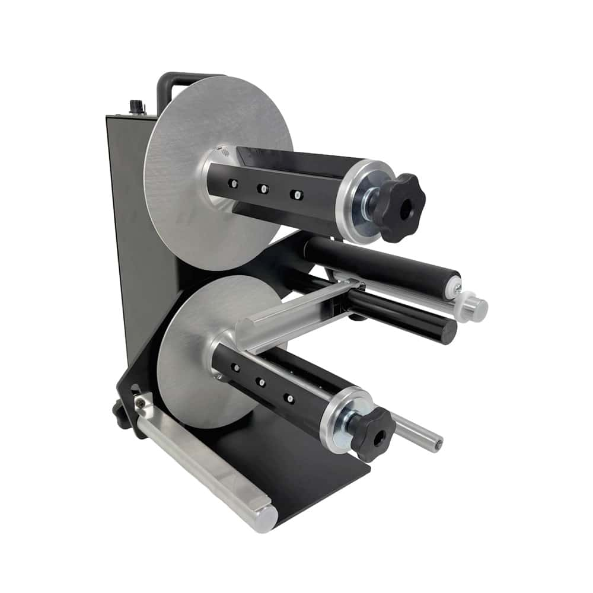

### Aplicación semiautomática sobre botellas

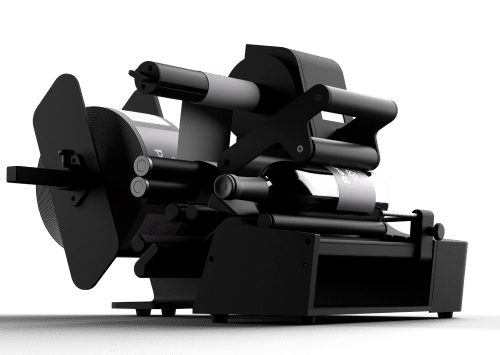

Para recipientes redondos, **Botlr** es una solución de aplicación semiautomática de etiquetas. La geometría del envase, el formato de la etiqueta y la presentación deseada deben validarse con muestras antes de concretar el equipo.

## Los complementos que marcan la diferencia

### Mandriles y adaptadores: sujetar bien la bobina

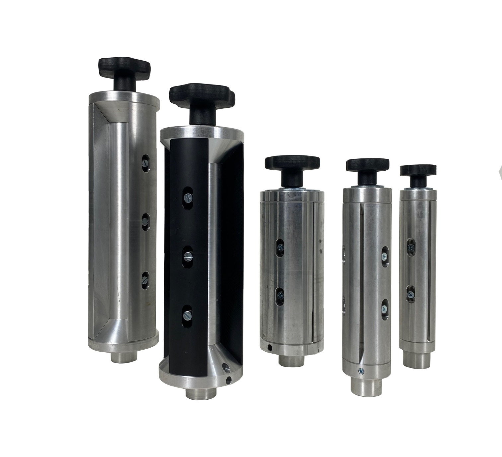

El diámetro interior del núcleo debe corresponder con el sistema de sujeción. Labelmate dispone de mandriles Quick-Chuck, soportes ajustables ACH y adaptadores para distintas configuraciones. Un mandril adecuado facilita los cambios y mantiene la bobina bien fijada; también hay que comprobar el ancho útil y la compatibilidad con el eje.

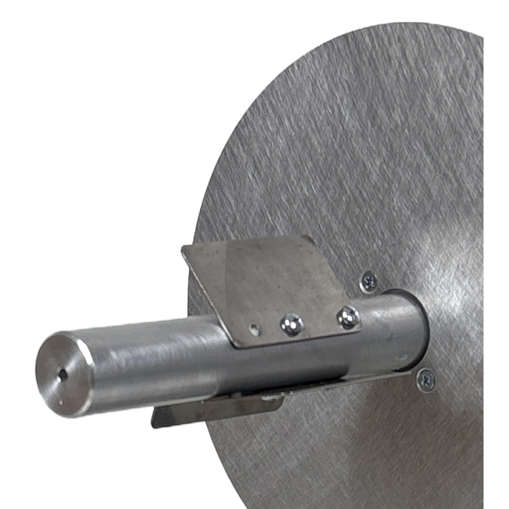

### Guías y platos laterales: mantener el material alineado

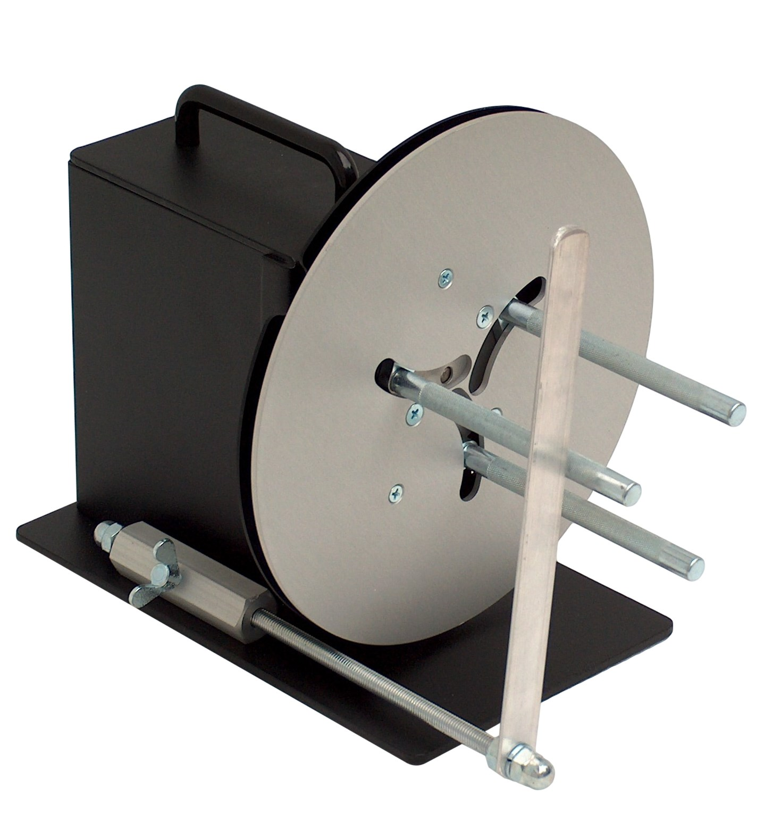

Las guías de material, los platos laterales y las placas de alineación ayudan a definir un recorrido estable. Una pequeña desviación a la salida de la impresora puede acumularse mientras crece la bobina. Hay que elegir el accesorio específico para el equipo y ajustarlo sin presionar ni deformar los bordes del soporte.

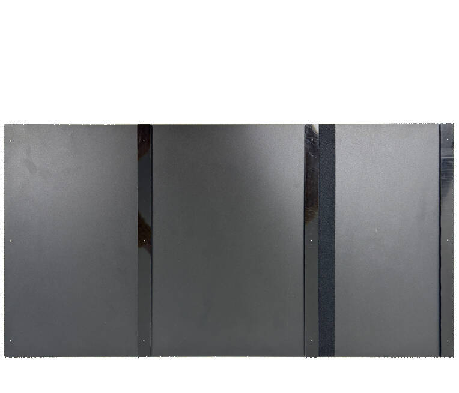

### Sensores: detectar el material real

La transparencia, el color, la separación y la forma de la etiqueta condicionan la detección. **La tecnología del sensor debe comprobarse en la ficha de cada modelo:** una denominación parecida entre familias no garantiza el mismo principio de funcionamiento.

Una prueba con el consumible definitivo resulta especialmente útil cuando hay etiquetas transparentes, formas irregulares o varias etiquetas en una misma banda.

### Tensión y retroceso: respetar el ciclo de la impresora

La tensión debe permitir formar una bobina estable sin interferir en el avance del soporte. Conviene observar el comportamiento en arranques, pausas y retrocesos, con la bobina vacía y también cuando aumenta de diámetro. Una velocidad máxima elevada, por sí sola, no determina que el rebobinador sea adecuado.

## Cómo elegir el accesorio según la necesidad

| Necesidad del proceso | Solución que valorar | Detalle que validar |
| --- | --- | --- |
| Recoger tiradas impresas | Rebobinador externo | Tensión, retroceso y sentido de bobinado |
| Alimentar desde una bobina externa | Desbobinador | Peso, diámetro y alineación de entrada |
| Facilitar el etiquetado manual | Dispensador | Detección y separación de la etiqueta |
| Preparar lotes con una cantidad definida | Estación de conteo | Sensor y parada por cantidad |
| Cambiar a menudo de formato | Mandril o soporte ajustable compatible | Diámetros de núcleo y tiempo de cambio |
| Preparar varias bandas estrechas | Corte longitudinal | Material, anchos y recogida final |

## Una prueba sencilla que evita errores de selección

Imaginemos una empresa que imprime etiquetas y después las coloca manualmente sobre cajas. Si las etiquetas se acumulan sobre la mesa, puede tener sentido recogerlas en una bobina. Si el tiempo se pierde separando cada etiqueta del soporte, puede resultar más útil un dispensador en el punto de aplicación. Si hay que entregar bobinas con una cantidad concreta, entra en juego el conteo.

**El primer paso es identificar dónde se produce la dificultad.** Después, hay que probar el conjunto con el material real y medir el tiempo por lote, los ajustes necesarios y las incidencias. Así se puede valorar la mejora con datos de la operativa.

## S-IE: seleccionar el conjunto para que cada detalle encaje

Para estudiar una configuración, envíanos el modelo exacto de impresora, las medidas de la etiqueta y del soporte, el diámetro interior del núcleo, el diámetro exterior y el peso de la bobina. Explícanos también el volumen de trabajo y qué ocurre después de la impresión.

En S-IE relacionamos esta información con la selección de equipos, [etiquetas y ribbons](/es/etiquetas-ribbons) y la organización del puesto de trabajo. Puedes ampliar los criterios con nuestras guías para [elegir una impresora de etiquetas industrial](/es/guias/como-elegir-impresora-etiquetas-industrial) y [escoger el ribbon adecuado](/es/guias/como-elegir-ribbon-cera-mixto-resina).

**¿Quieres mejorar la recogida, la dispensación o la preparación de tus etiquetas?** [Explícanos tu proceso](/es/contacto). Te ayudaremos a definir qué accesorios Labelmate encajan con tu aplicación y qué detalles conviene validar antes de decidir.

## Preguntas frecuentes sobre accesorios de etiquetado

### ¿Cualquier rebobinador sirve para cualquier impresora?

Hay que comprobar ancho, velocidad, tensión, retroceso, capacidad de bobina y alineación. Compartir marca de impresora con una aplicación de referencia no confirma la compatibilidad de todos los modelos.

### ¿Cómo se elige un dispensador para etiquetas transparentes?

Se debe elegir una versión especificada para ese material y probar la detección y la separación con la etiqueta real. También cuentan el soporte, la forma y la longitud.

### ¿Un accesorio puede mejorar el resultado sin cambiar la impresora?

Sí, cuando la limitación se encuentra en la alimentación, la recogida o la manipulación. La mejora debe valorarse sobre el proceso completo y con una prueba de funcionamiento.

### ¿Qué diferencia hay entre un dispensador y un aplicador?

El dispensador presenta la etiqueta para recogerla. Un aplicador la coloca sobre el producto según el mecanismo y el nivel de automatización del equipo.

## Fuentes técnicas

Información de producto consultada en el fabricante: [rebobinadores](https://labelmate.com/product-categorie/label-rewinders/), [MC-PRO y control de tensión](https://labelmate.com/news/mc-pro-stc/), [desbobinadores](https://labelmate.com/product-categorie/label-unwinders/), [dispensadores](https://labelmate.com/product-categorie/label-dispensers/), [contadores](https://labelmate.com/product-categorie/label-counters/), [accesorios](https://labelmate.com/product-categorie/accessories/), [corte longitudinal](https://labelmate.com/product-categorie/label-slitting-solutions/), [retirada de matriz](https://labelmate.com/product-categorie/matrix-removal/) y [Botlr](https://labelmate.com/news/botlr/). Imágenes de producto y accesorios: Labelmate. Las fotografías muestran ejemplos de configuración; los complementos incluidos dependen de cada referencia.
