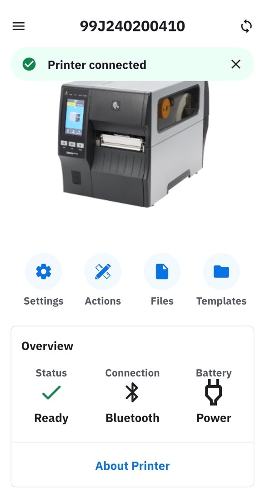
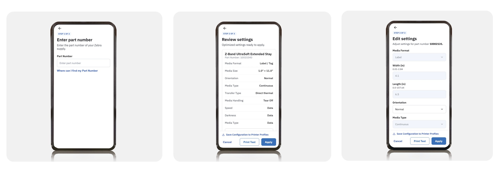

**Zebra Nucleus Connector es la aplicación gratuita de Zebra para facilitar la puesta en marcha y la configuración de impresoras de etiquetas compatibles.** La renovación de la herramienta incorpora una interfaz más clara, configuración guiada y perfiles reutilizables. También permite ajustar consumibles del catálogo Zebra ZipShip y preparar la incorporación de la impresora al entorno de gestión Zebra Nucleus.

Para una empresa que imprime etiquetas de producto, identifica cajas o prepara expediciones, esta novedad tiene una utilidad concreta: establecer una configuración de trabajo coherente y facilitar su aplicación cuando se instala o se sustituye una impresora. En S-IE nos interesa especialmente cómo puede ayudar a los equipos de almacén, producción y mantenimiento a realizar una puesta en marcha más ordenada.

## ¿Qué es Zebra Nucleus Connector y qué cambia?

La aplicación acompaña al usuario en las tareas de conexión, configuración y ajuste de la impresora. Según el modelo y la versión, agrupa parámetros de conectividad, seguridad, consumibles e inscripción en Nucleus, con una experiencia de configuración similar entre móvil y ordenador.

En **Android e iOS**, Nucleus Connector toma el relevo de la aplicación móvil **Zebra Printer Setup Utility**, con una nueva imagen y funciones ampliadas.

En **Windows**, conviene distinguir las herramientas: **Zebra Setup Utilities (ZSU) sigue disponible** para instalar controladores y configurar impresoras. Nucleus Connector para Windows se centra en la configuración guiada, especialmente en la puesta en marcha de seguridad de los equipos EMEA. **No instala los controladores de impresión.**

Antes de elegir la aplicación, conviene comprobar el modelo, el firmware y el sistema operativo. Las funciones y las conexiones disponibles varían entre equipos.

## Configurar una impresora Zebra desde el móvil

El proceso que presenta Zebra se divide en tres pasos:

1. **Instalar la aplicación oficial** en Android o iOS.
2. **Localizar y conectar la impresora** con un método compatible con el equipo y con su estado de seguridad.
3. **Aplicar los ajustes o un perfil preparado**, revisar los parámetros y realizar una prueba de impresión.

Esto facilita tareas como revisar la conexión, seleccionar el tipo de soporte o ajustar la calidad de impresión desde un dispositivo móvil. El descubrimiento en la red, el emparejamiento Bluetooth o el uso de NFC dependen de las capacidades de la impresora y de la configuración habilitada.

*Interfaz mostrada en la presentación de Zebra. Las capturas originales están en inglés.*

La prueba final debe reflejar el trabajo real: una etiqueta con los datos habituales, el código de barras y el consumible que se utilizará en producción. Poder conectar con la impresora es el primer paso; también hay que confirmar que la impresión y la lectura del código sean correctas.

## Perfiles de configuración para desplegar impresoras

Una de las funciones más interesantes es la posibilidad de **guardar configuraciones y agruparlas en perfiles de impresora**. Un perfil puede reunir ajustes de conectividad, seguridad y consumibles, así como la inscripción en Nucleus cuando corresponda.

La utilidad se aprecia, por ejemplo, en un almacén con varios puntos de preparación de pedidos que trabajan con la misma etiqueta. Definir y probar una configuración de referencia ayuda a repetir los ajustes aprobados cuando se añade un equipo o se prepara una sustitución.

En despliegues compatibles, Zebra también contempla la aplicación de perfiles mediante NFC. Hay que revisar los valores particulares de cada impresora, como el nombre del equipo o la dirección IP, antes de reutilizar una configuración. Un perfil validado en un modelo tampoco debe aplicarse automáticamente a una impresora de resolución o características distintas.

## Simple Supplies Setup: ajustes a partir de la referencia del consumible

**Zebra Simple Supplies Setup** permite introducir la referencia de un consumible del **catálogo Zebra ZipShip** para que la aplicación proponga los ajustes conocidos para ese producto. El usuario los revisa, puede realizar una prueba de impresión y aplica la configuración.

*Secuencia de configuración de consumibles extraída de la presentación de Zebra.*

Esta función puede facilitar el cambio de referencia y ayudar a reducir errores de ajuste. **La selección automática se basa en consumibles Zebra ZipShip identificados por su referencia.** Para etiquetas a medida o materiales de otros fabricantes, hay que definir y probar los parámetros adecuados al conjunto de etiqueta, ribbon e impresora.

En las impresoras de pulseras **ZD510-HC y HC100**, Zebra indica que los ajustes del soporte son de solo lectura. Es una particularidad que debe tenerse en cuenta en aplicaciones sanitarias.

## Puesta en marcha de seguridad y EU RED

Algunas impresoras Zebra comercializadas en EMEA incorporan una configuración inicial de seguridad con determinadas funciones de comunicación o gestión restringidas. Zebra ofrece en Nucleus Connector un asistente para revisar estos parámetros en los equipos afectados por los requisitos de ciberseguridad de EU RED.

En el procedimiento oficial para **Windows**, Zebra especifica una **conexión USB física para la configuración inicial**. La presentación señala que este asistente no requiere acceso a Internet para ejecutar la configuración local, una vez se dispone de la aplicación.

La configuración debe adaptarse a los servicios que realmente necesita la empresa y a los criterios de su equipo informático. El asistente ayuda a preparar la impresora, pero el resultado también depende de la red, los permisos y la política de seguridad de la organización.

## Conexión con Zebra Nucleus y alcance de la aplicación

Cuando una empresa utiliza **Zebra Nucleus** como plataforma de gestión de dispositivos, Nucleus Connector permite inscribir la impresora. Esta función forma parte de un despliegue más amplio: deben comprobarse la compatibilidad y las condiciones del servicio de gestión.

Nucleus Connector se centra en la configuración del dispositivo. El **diseño de las etiquetas, los datos del ERP y la automatización de la impresión** siguen requiriendo las herramientas y las integraciones correspondientes, como las soluciones de etiquetado con [BarTender o Loftware que podemos valorar en S-IE](/es/software).

## Cómo te ayudamos en S-IE

En S-IE podemos valorar el parque de impresoras, definir los ajustes según el consumible y preparar perfiles de trabajo. La puesta en marcha incluye comprobar la comunicación con las aplicaciones de gestión y validar la calidad de la etiqueta y la lectura del código de barras.

Si quieres incorporar una impresora, renovar los equipos del almacén o revisar una configuración que da problemas, [contacta con S-IE](/es/contacto). Indícanos el modelo, la conexión actual y el tipo de etiqueta y ribbon que utilizas. Con estos datos podemos orientar mejor la revisión.

## Preguntas frecuentes sobre Zebra Nucleus Connector

### ¿Es gratuito?

Sí. Zebra presenta Nucleus Connector como una aplicación gratuita de configuración. Las condiciones de la plataforma de gestión Zebra Nucleus deben revisarse por separado.

### ¿Funciona con cualquier impresora Zebra?

Hay que comprobar la compatibilidad del modelo y del firmware en la documentación oficial. Las conexiones y las funciones disponibles dependen del equipo.

### ¿Sustituye a Zebra Setup Utilities en Windows?

Zebra Setup Utilities sigue disponible, especialmente para instalar controladores. Nucleus Connector para Windows es una herramienta complementaria para la configuración guiada de seguridad de los equipos EMEA.

### ¿Ajusta automáticamente cualquier etiqueta?

Simple Supplies Setup utiliza referencias del catálogo Zebra ZipShip. Las etiquetas a medida y otros materiales requieren una configuración y una prueba adaptadas a la aplicación.

*Fuentes: presentación de producto Zebra Nucleus Connector, 2026; [descargas y documentación oficial de Zebra](https://www.zebra.com/us/en/support-downloads/software/printer-software/zebra-nucleus-connector.html); [procedimiento de configuración EU RED para Windows](https://support.zebra.com/article/000035967). Imágenes: Zebra Technologies, extraídas de la presentación facilitada. Las funciones pueden variar según el modelo, el firmware y la versión de la aplicación.*
